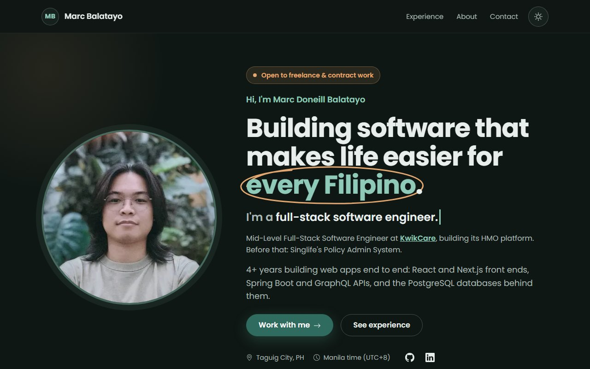
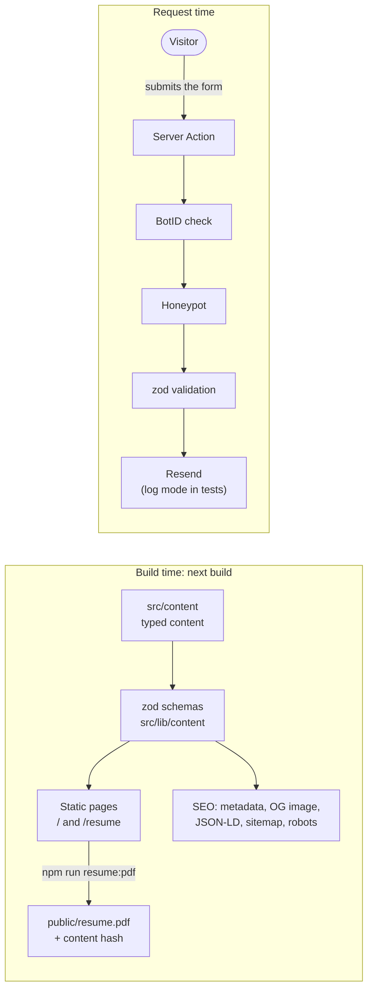

# marc-doneill-dev-portfolio

The portfolio of Marc Doneill Balatayo, a full-stack software engineer. It's a small, statically prerendered Next.js site, and it's also a code sample: typed content, tests at every layer and a bundle budget.

**Live:** https://marc-doneill-dev-portfolio.vercel.app

[](https://github.com/marcdev06/marc-doneill-dev-portfolio/actions/workflows/ci.yml)



## Features

- **Home page:** a hero with the mission headline, a typewriter role line and availability; an experience timeline; skills in three tiers around an orbit; about; and contact.
- **Themes:** dark by default, with a light theme that persists and doesn't flash on load. Motion is light: CSS animations (scroll reveals, the skills orbit, hover lifts) plus a small typewriter island. All of it switches off under `prefers-reduced-motion`.
- **Resume:** a print-styled `/resume` page and a downloadable `public/resume.pdf`, both generated from the site's own content.
- **Contact form:** a Server Action with server-side validation, email through [Resend](https://resend.com), and spam protection from a honeypot and [Vercel BotID](https://vercel.com/docs/botid). Without JavaScript it still posts through the Server Action; on Vercel, BotID will likely treat such posts as bots, so the visitor gets the email fallback.
- **SEO:** absolute canonical and Open Graph URLs, a generated 1200×630 Open Graph image, `ProfilePage` JSON-LD, `sitemap.xml` and `robots.txt`.
- **Analytics:** cookie-less Vercel Web Analytics, rendered only on Vercel.
- **Security headers:** `nosniff`, a referrer policy, a permissions policy and a frame-blocking CSP.

## Architecture



### Folders

| Folder            | What lives there                                                                                                          |
| ----------------- | ------------------------------------------------------------------------------------------------------------------------- |
| `src/app/`        | Routes, the Open Graph image, `robots.ts` and `sitemap.ts`. Routes stay thin and only compose.                            |
| `src/components/` | Shared UI: `sections/`, `resume/`, `seo/` and `ui/`. Server Components by default; client islands are small.              |
| `src/features/`   | Self-contained features. Today that's `contact/`: the form island, the Server Action, delivery and BotID.                 |
| `src/lib/`        | Pure TypeScript with no React or Next: the site URL, content schemas, contact validation and the SEO builders in `seo/`.  |
| `src/content/`    | The site's content as typed modules, each validated by its schema when it loads.                                          |
| `src/styles/`     | Bootstrap Sass variable overrides for both themes, design tokens as custom properties, and the Bootstrap partials in use. |
| `assets/`         | Build-time files that aren't served: the Poppins TTFs and their licence, used by the Open Graph image.                    |
| `docs/`           | The README screenshot.                                                                                                    |
| `scripts/`        | `generate-resume-pdf.ts`, run with Node's built-in TypeScript support.                                                    |
| `e2e/`, `test/`   | Playwright specs, and shared Vitest helpers and content fixtures.                                                         |

### Layer rules

ESLint's `no-restricted-imports` enforces the layers:

- `src/lib/**` must not import React, Next, `@/components`, `@/features` or `@/app`.
- `src/components/**` must not import `@/features` or `@/app`. The contact form reaches the page through a slot prop.
- `src/content/**` may import only `@/lib/content`.

Client components import content types with `import type` only, so zod never reaches the browser.

### Content pipeline

Every piece of copy lives in `src/content/` and is parsed by a zod schema from `src/lib/content/` when it loads, so invalid content fails the build. The static pages, the SEO metadata, the JSON-LD and the Open Graph image all read the same content.

The resume is composed from the same profile, experience, skills and education. `npm run resume:pdf` builds the site, renders `/resume` with Playwright to `public/resume.pdf` (A4, one page) and writes a hash of the content it used to `public/resume.meta.json`. A Vitest test recomputes the hash and fails if the content changed without regenerating the PDF. PDF bytes aren't deterministic, so the test compares the content hash, not the file.

### Contact flow

The form is a small client island using React 19's `useActionState`, with native constraint validation. Without JavaScript it still posts through the same Server Action, but on Vercel such a post carries no BotID headers, so BotID will likely class it as a bot and the visitor gets the email fallback. Locally, where BotID answers human, no-JS posts succeed. On the server, the action:

1. asks BotID whether the request came from a bot, and fails closed if it did or if the check errors;
2. returns success without sending if the honeypot field is filled, so bots learn nothing;
3. validates the fields with zod and returns per-field errors;
4. sends a plain-text email through Resend, with the visitor as `Reply-To`.

Tests and CI never send email: `CONTACT_DELIVERY=log` prints the message instead. BotID only verifies visitors on Vercel. Elsewhere it answers human, and its client never loads. To keep first-load JavaScript within budget, the BotID client starts only when the form comes within 800 px of the viewport or gets focus. A submit before that carries no BotID headers, so it fails closed and shows Marc's email address instead.

The site doesn't store messages. Resend keeps its own sending logs.

## Quality

Numbers are as measured at v1.0.0.

- **Unit and component tests:** 168 Vitest tests in 35 files, with React Testing Library. Coverage thresholds: 100% for `src/lib/**`, 90% for `src/components/**` and `src/features/**`.
- **End-to-end tests:** 47 Playwright tests, each run on a 1280 px desktop and a Pixel 5 (89 runs pass; 5 apply to one viewport only and skip on the other). They cover navigation, themes, motion, the contact form, SEO tags, `robots.txt`, `sitemap.xml`, the Open Graph image, security headers, and pages free of console errors and failed requests.
- **Accessibility:** axe reports zero violations on every page, in both themes, on desktop and mobile, and in every contact form state.
- **Bundle budget:** `/` loads at most 160 kB of gzipped JavaScript and 25 kB of gzipped CSS. At v1.0.0 it's 159.1 kB and 23.6 kB on a Vercel-like build. The measurement parses the prerendered HTML, gzips (level 9) every script and stylesheet it loads, and skips `noModule` polyfills.
- **Lighthouse CI:** `/` and `/resume`, mobile emulation, median of 3 runs; each category must score at least 0.95. At v1.0.0 both pages score 100 in performance, accessibility, best practices and SEO on a local run.
- **CI:** GitHub Actions runs formatting, lint, typecheck, unit tests with coverage, build, Playwright with axe, and Lighthouse CI on every pull request and push to `staging` and `main`. Lighthouse reports are kept as an artifact for 7 days.

## Key decisions

| Decision                         | Why                                                                                                                                                                                                                     |
| -------------------------------- | ----------------------------------------------------------------------------------------------------------------------------------------------------------------------------------------------------------------------- |
| Bootstrap 5.3 Sass over Tailwind | Bootstrap is in Marc's stack. One styling system, themed through Sass variables and importing only the partials in use, reads cleaner than two resets with colliding class names.                                       |
| Static prerendering everywhere   | Every route, including the Open Graph image, `robots.txt` and `sitemap.xml`, is built once. The contact Server Action is the only server code at request time.                                                          |
| zod on the server only           | zod would cost more than the remaining JavaScript budget. The form uses native validation; the Server Action validates for real.                                                                                        |
| BotID without `withBotId`        | Vercel's current BotID docs say the config wrapper and its rewrites are no longer needed. BotID's own bypass keys on `NODE_ENV`, so the server check is bypassed off Vercel through its documented development options. |
| Resume generated from content    | One source of truth: the PDF can't drift from the site, and a content-hash test catches a stale PDF.                                                                                                                    |
| A bundle budget for `/`          | 160 kB gzipped JavaScript and 25 kB CSS, measured on every milestone. It's why BotID's client loads lazily.                                                                                                             |
| A CSP without `script-src`       | A script CSP on static Next.js pages needs per-request nonces, which force dynamic rendering. The CSP covers framing, `<base>`, form targets and plugins; Vercel adds HSTS.                                             |

## Getting started

Requires Node 24 (see `.nvmrc`).

```bash
npm ci
npm run dev
```

Open http://localhost:3000. Copy `.env.example` to `.env.local` to set the variables below. Before the first e2e run, install the browser with `npx playwright install chromium`. Lighthouse CI uses your local Chrome.

### Scripts

| Script                 | What it does                                                    |
| ---------------------- | --------------------------------------------------------------- |
| `npm run dev`          | Start the dev server                                            |
| `npm run build`        | Production build                                                |
| `npm run start`        | Serve the production build                                      |
| `npm run typecheck`    | Generate route types, then run `tsc --noEmit`                   |
| `npm run lint`         | ESLint, including the layer guards                              |
| `npm run format`       | Format with Prettier                                            |
| `npm run format:check` | Check formatting                                                |
| `npm run test`         | Unit and component tests (Vitest)                               |
| `npm run test:watch`   | Vitest in watch mode                                            |
| `npm run coverage`     | Tests with coverage thresholds                                  |
| `npm run e2e`          | Build, serve on ports 4318 and 4319 and run Playwright with axe |
| `npm run lighthouse`   | Lighthouse CI on port 4320 against the last build               |
| `npm run resume:pdf`   | Build, then render `/resume` to `public/resume.pdf`             |

### Environment variables

| Variable               | Needed        | What it does                                                                                                    |
| ---------------------- | ------------- | --------------------------------------------------------------------------------------------------------------- |
| `NEXT_PUBLIC_SITE_URL` | No            | The site's base URL for canonical and Open Graph links. Falls back to Vercel's production host, then localhost. |
| `CONTACT_DELIVERY`     | No            | `resend` (the default) emails messages; `log` prints them to the server console.                                |
| `RESEND_API_KEY`       | With `resend` | Resend API key. Server only; never commit a real one.                                                           |
| `CONTACT_TO_EMAIL`     | With `resend` | The inbox that receives contact messages.                                                                       |
| `CONTACT_FROM_EMAIL`   | No            | The sender. Defaults to `Portfolio contact <onboarding@resend.dev>`.                                            |

Vercel sets four more on its own: `VERCEL` and `NEXT_PUBLIC_VERCEL_ENV` switch on BotID and analytics, `VERCEL_ENV` keeps previews out of search engines through `robots.txt`, and `VERCEL_PROJECT_PRODUCTION_URL` supplies the default site URL.

### Deploying on Vercel

1. Import the repository. Set the production branch to `main` and Node.js to 24.x.
2. Add `RESEND_API_KEY` and `CONTACT_TO_EMAIL` for Production and Preview. `NEXT_PUBLIC_SITE_URL` is only needed for a custom domain.
3. Keep system environment variables exposed and OIDC Federation on (both are defaults). BotID needs them.
4. Enable Web Analytics under Project → Analytics.

Pushes to other branches get preview deployments, which `robots.txt` and Vercel both keep out of search engines.

## Credits

- Technology logos from [Simple Icons](https://simpleicons.org/) (CC0); interface icons from [Bootstrap Icons](https://icons.getbootstrap.com/) (MIT).
- [Poppins](https://github.com/itfoundry/Poppins) by the Poppins Project Authors, under the [SIL Open Font License 1.1](assets/fonts/poppins/OFL.txt).
- The profile photo is © Marc Doneill Balatayo.

## Licence

There is no open-source licence. The code is public for reference and review. The code and the content (text, photo and resume) are © Marc Doneill Balatayo, all rights reserved. The third-party works credited above keep their own licences.
