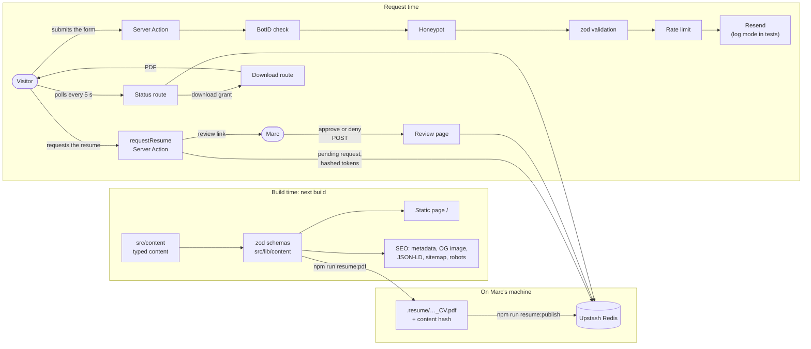

# marc-doneill-dev-portfolio

The portfolio of Marc Doneill Balatayo, a full-stack software engineer. It's a small, mostly static Next.js site, and it's also a code sample: typed content, tests at every layer and a bundle budget.

**Live:** https://marc-doneill-dev-portfolio.vercel.app

[](https://github.com/marcdev06/marc-doneill-dev-portfolio/actions/workflows/ci.yml)


## Features

- **Home page:** a hero with the mission headline, a typewriter role line and availability; an experience timeline; skills in three tiers around an orbit; about; and contact.
- **Themes:** dark by default, with a light theme that persists and doesn't flash on load. Motion is light: CSS animations (scroll reveals, the skills orbit, hover lifts) plus a small typewriter island. All of it switches off under `prefers-reduced-motion`.
- **Gated resume:** a "Request my resume" dialog collects a name and email. Marc approves or denies each request from an emailed review link while the dialog waits, then the PDF downloads through a short-lived, three-use link. There's no public resume page or PDF.
- **Resume PDF:** a one-page, two-column A4 CV generated from the site's own content, tagged for screen readers and laid out in an ATS-friendly reading order.
- **Contact form:** a Server Action with server-side validation, email through [Resend](https://resend.com), and spam protection from a honeypot, [Vercel BotID](https://vercel.com/docs/botid) and a per-IP rate limit. Without JavaScript it still posts through the Server Action; on Vercel, BotID will likely treat such posts as bots, so the visitor is pointed to LinkedIn instead.
- **Privacy:** no email address or email link anywhere on the site. Rate-limit keys hash IPs and emails, and resume requests are deleted after 24 hours.
- **SEO:** absolute canonical and Open Graph URLs, a generated 1200×630 Open Graph image, `ProfilePage` JSON-LD, `sitemap.xml` and `robots.txt`.
- **Analytics:** cookie-less Vercel Web Analytics, rendered only on Vercel.
- **Security headers:** `nosniff`, a referrer policy, a permissions policy and a frame-blocking CSP. Review links add `noindex`, `no-store` and `no-referrer`.

## Architecture



### Folders

| Folder            | What lives there                                                                                                                                                     |
| ----------------- | -------------------------------------------------------------------------------------------------------------------------------------------------------------------- |
| `src/app/`        | Routes, the Open Graph image, `robots.ts`, `sitemap.ts`, the review page and the resume Route Handlers. Routes stay thin and only compose.                           |
| `src/components/` | Shared UI: `sections/`, `resume/`, `seo/` and `ui/`. Server Components by default; client islands are small.                                                         |
| `src/features/`   | Self-contained features: `contact/`, `resume-request/` (dialog, Server Actions, Route Handler logic, review page), `request-store/`, `email/` and `bot-protection/`. |
| `src/lib/`        | Pure TypeScript with no React or Next: the site URL, content schemas, contact validation, SEO builders, the key-value store and the resume request state machine.    |
| `src/content/`    | The site's content as typed modules, each validated by its schema when it loads, plus the resume PDF's content hash.                                                 |
| `src/styles/`     | Bootstrap Sass variable overrides for both themes, design tokens as custom properties, and the Bootstrap partials in use.                                            |
| `assets/`         | Build-time files that aren't served: the Poppins TTFs and their licence, used by the Open Graph image.                                                               |
| `docs/`           | The README screenshot.                                                                                                                                               |
| `scripts/`        | `generate-resume-pdf.ts` and `publish-resume-pdf.ts`, run with Node's built-in TypeScript support.                                                                   |
| `e2e/`, `test/`   | Playwright specs and a fixture PDF, and shared Vitest helpers and content fixtures.                                                                                  |

### Layer rules

ESLint's `no-restricted-imports` enforces the layers:

- `src/lib/**` must not import React, Next, `@/components`, `@/features` or `@/app`.
- `src/components/**` must not import `@/features` or `@/app`. The contact form and the resume button reach the page through slot props.
- `src/content/**` may import only `@/lib/content`.

Client components import content types with `import type` only, so zod never reaches the browser. Token hashing, zod and `@upstash/*` stay on the server too.

### Content pipeline

Every piece of copy lives in `src/content/` and is parsed by a zod schema from `src/lib/content/` when it loads, so invalid content fails the build. The static page, the SEO metadata, the JSON-LD and the Open Graph image all read the same content.

The resume is composed from the same profile, experience, skills, education and site description. `npm run resume:pdf` builds the site, renders the local-only `/resume` page with Playwright to `.resume/Marc_Doneill_Balatayo_CV.pdf` (A4, one page, tagged) and writes a hash of the content it used to `src/content/resume.meta.json`. A Vitest test recomputes the hash and fails if the content changed without regenerating the PDF. PDF bytes aren't deterministic, so the test compares the content hash, not the file. The email in the PDF comes from `CONTACT_TO_EMAIL` at generation time and stays out of the hash and out of every Vercel build; `/resume` renders a static 404 on Vercel.

### Contact flow

The form is a small client island using React 19's `useActionState`, with native constraint validation. Without JavaScript it still posts through the same Server Action, but on Vercel such a post carries no BotID headers, so BotID will likely class it as a bot and the visitor is pointed to LinkedIn. Locally, where BotID answers human, no-JS posts succeed. On the server, the action:

1. asks BotID whether the request came from a bot, and fails closed if it did or if the check errors;
2. returns success without sending if the honeypot field is filled, so bots learn nothing;
3. validates the fields with zod and returns per-field errors;
4. allows 5 messages per IP per hour (without Redis it skips the limit and logs why);
5. sends a plain-text email through Resend, with the visitor as `Reply-To`.

Tests and CI never send email: `CONTACT_DELIVERY=log` prints the message instead. BotID only verifies visitors on Vercel. Elsewhere it answers human, and its client never loads. To keep first-load JavaScript within budget, the BotID client starts only when the form comes within 800 px of the viewport, gets focus, or the resume dialog opens. A submit before that carries no BotID headers, so it fails closed.

The site doesn't store messages. Resend keeps its own sending logs.

### Resume request flow

The "Request my resume" button is a tiny client island; the dialog (a native `<dialog>`) loads with `import()` on first use, so it isn't in first-load JavaScript. Without JavaScript the button is a link to the contact section.

1. The `requestResume` Server Action runs BotID, the honeypot and zod, then the rate limits: 3 requests per IP, 2 per email and 20 site-wide per day, keyed by SHA-256 hashes. The visitor never learns which limit was hit.
2. It stores a pending request in Upstash Redis with a 128-bit id and two 32-byte tokens, keeping only their SHA-256 hashes, and emails Marc a plain-text summary with a review link. Previews link to their own branch URL.
3. The dialog polls a status Route Handler every 5 seconds with the requester token, and announces each change once in a polite live region.
4. The review page only displays the request on GET, because mail scanners prefetch links. Marc's Approve and Deny buttons are POSTed Server Actions, and the first decision wins. After 15 minutes the request expires, and the page asks Marc to reply by email instead.
5. On approval the status response carries a download grant, valid for 5 minutes and 3 downloads. The dialog starts the download and shows a "Download the PDF" link. The download route streams the published PDF from Redis with `Content-Disposition: attachment`, `no-store` and `noindex`.

Missing Redis configuration on Vercel fails closed with a server-only log. Tests and e2e use an in-memory store (`RESUME_REQUEST_STORE=memory`), which can't run on Vercel.

## Quality

Numbers are as measured at v1.0.0.

- **Unit and component tests:** 326 Vitest tests in 55 files, with React Testing Library. Coverage thresholds: 100% for `src/lib/**`, 90% for `src/components/**` and `src/features/**`.
- **End-to-end tests:** 65 Playwright tests, each run on a 1280 px desktop and a Pixel 5 (125 runs pass; 5 apply to one viewport only and skip on the other). They cover navigation, themes, motion, the contact form, the resume request flow (approve and download, deny, expiry, rate limit, failure), SEO tags, `robots.txt`, `sitemap.xml`, the Open Graph image, privacy, security headers, and pages free of console errors and failed requests.
- **Accessibility:** axe reports zero violations on every page, in both themes, on desktop and mobile, in every contact form state and in every resume dialog state.
- **Bundle budget:** `/` loads at most 160 kB of gzipped JavaScript and 25 kB of gzipped CSS. At v1.0.0 it's 159.6 kB and 23.6 kB on a Vercel-like build; the resume dialog loads separately. The measurement parses the prerendered HTML, gzips (level 9) every script and stylesheet it loads, and skips `noModule` polyfills.
- **Lighthouse CI:** `/`, mobile emulation, median of 3 runs; each category must score at least 0.95. At v1.0.0 it scores 100 in performance, accessibility, best practices and SEO on a local run.
- **CI:** GitHub Actions runs formatting, lint, typecheck, unit tests with coverage, build, Playwright with axe, and Lighthouse CI on every pull request and push to `staging` and `main`. Lighthouse reports are kept as an artifact for 7 days.

## Key decisions

| Decision                                         | Why                                                                                                                                                                                                                                            |
| ------------------------------------------------ | ---------------------------------------------------------------------------------------------------------------------------------------------------------------------------------------------------------------------------------------------- |
| Bootstrap 5.3 Sass over Tailwind                 | Bootstrap is in Marc's stack. One styling system, themed through Sass variables and importing only the partials in use, reads cleaner than two resets with colliding class names.                                                              |
| Static prerendering everywhere it can            | Every public page, including the Open Graph image, `robots.txt` and `sitemap.xml`, is built once. Only the Server Actions, the review page and the two resume Route Handlers run at request time.                                              |
| zod on the server only                           | zod would cost more than the remaining JavaScript budget. The forms use native validation; the Server Actions validate for real.                                                                                                               |
| BotID without `withBotId`                        | Vercel's current BotID docs say the config wrapper and its rewrites are no longer needed. BotID's own bypass keys on `NODE_ENV`, so the server check is bypassed off Vercel through its documented development options.                        |
| Resume generated from content                    | One source of truth: the PDF can't drift from the site, and a content-hash test catches a stale PDF.                                                                                                                                           |
| Gated resume: approve link, waiting popup, Redis | Marc approves each request himself. Without a custom domain Resend can only email Marc, so the visitor's dialog waits for the decision instead of receiving an email. Redis holds short-lived requests, hashed tokens and rate-limit counters. |
| A bundle budget for `/`                          | 160 kB gzipped JavaScript and 25 kB CSS, measured on every milestone. It's why BotID's client and the resume dialog load lazily.                                                                                                               |
| A CSP without `script-src`                       | A script CSP on static Next.js pages needs per-request nonces, which force dynamic rendering. The CSP covers framing, `<base>`, form targets and plugins; Vercel adds HSTS.                                                                    |

## Getting started

Requires Node 24 (see `.nvmrc`).

```bash
npm ci
npm run dev
```

Open http://localhost:3000. Copy `.env.example` to `.env.local` to set the variables below. Before the first e2e run, install the browser with `npx playwright install chromium`. Lighthouse CI uses your local Chrome.

To try the resume request locally without Redis, set `RESUME_REQUEST_STORE=memory` and `CONTACT_DELIVERY=log`; the review link appears in the server log.

### Scripts

| Script                   | What it does                                                                                       |
| ------------------------ | -------------------------------------------------------------------------------------------------- |
| `npm run dev`            | Start the dev server                                                                               |
| `npm run build`          | Production build                                                                                   |
| `npm run start`          | Serve the production build                                                                         |
| `npm run typecheck`      | Generate route types, then run `tsc --noEmit`                                                      |
| `npm run lint`           | Generate route types, then ESLint with the layer guards                                            |
| `npm run format`         | Format with Prettier                                                                               |
| `npm run format:check`   | Check formatting                                                                                   |
| `npm run test`           | Unit and component tests (Vitest)                                                                  |
| `npm run test:watch`     | Vitest in watch mode                                                                               |
| `npm run coverage`       | Tests with coverage thresholds                                                                     |
| `npm run e2e`            | Build, serve on ports 4318, 4319 and 4321 and run Playwright with axe                              |
| `npm run lighthouse`     | Lighthouse CI on port 4320 against the last build                                                  |
| `npm run resume:pdf`     | Build, then render `/resume` to `.resume/Marc_Doneill_Balatayo_CV.pdf` and update the content hash |
| `npm run resume:publish` | Upload the generated PDF to Redis, using the credentials in `.env.local`                           |

### Environment variables

| Variable                                                                                                                     | Needed              | What it does                                                                                                                                                                |
| ---------------------------------------------------------------------------------------------------------------------------- | ------------------- | --------------------------------------------------------------------------------------------------------------------------------------------------------------------------- |
| `NEXT_PUBLIC_SITE_URL`                                                                                                       | No                  | The site's base URL for canonical and Open Graph links and the resume PDF. Falls back to Vercel's production host, then localhost.                                          |
| `CONTACT_DELIVERY`                                                                                                           | No                  | `resend` (the default) emails messages and resume requests; `log` prints them to the server console.                                                                        |
| `RESEND_API_KEY`                                                                                                             | With `resend`       | Resend API key. Server only; never commit a real one.                                                                                                                       |
| `CONTACT_TO_EMAIL`                                                                                                           | With `resend`       | Marc's inbox for contact messages and resume requests. `npm run resume:pdf` also prints it in the PDF; it never reaches a public page.                                      |
| `CONTACT_FROM_EMAIL`                                                                                                         | No                  | The sender. Defaults to `Portfolio contact <onboarding@resend.dev>`.                                                                                                        |
| `KV_REST_API_URL`, `KV_REST_API_TOKEN`                                                                                       | For resume requests | Upstash Redis, added by the Vercel Marketplace integration. The Upstash dashboard's `UPSTASH_REDIS_REST_URL` and `_TOKEN` work too.                                         |
| `RESUME_REQUEST_STORE`                                                                                                       | Tests only          | `memory` keeps requests and limits in memory for unit tests and e2e. It fails closed on Vercel.                                                                             |
| `RESUME_REQUEST_PENDING_WINDOW_SECONDS`, `RESUME_REQUEST_SITE_DAILY_LIMIT`, `RESUME_REQUEST_FIXTURE_PDF`, `CONTACT_LOG_FILE` | E2e only            | Shorten the approval window, raise the site-wide limit, seed a fixture PDF and log emails to a file. They work only with the memory store or log delivery, never on Vercel. |

Vercel sets more on its own: `VERCEL` and `NEXT_PUBLIC_VERCEL_ENV` switch on BotID and analytics, `VERCEL_ENV` keeps previews out of search engines and keys Redis data by environment, `VERCEL_BRANCH_URL` builds preview review links, and `VERCEL_PROJECT_PRODUCTION_URL` supplies the default site URL.

### Deploying on Vercel

1. Import the repository. Set the production branch to `main` and Node.js to 24.x.
2. Add `RESEND_API_KEY` and `CONTACT_TO_EMAIL` for Production and Preview. `NEXT_PUBLIC_SITE_URL` is only needed for a custom domain.
3. Add Upstash Redis (free plan) from the Vercel Marketplace, connected to Production and Preview.
4. Keep system environment variables exposed and OIDC Federation on (both are defaults). BotID needs them.
5. Enable Web Analytics under Project → Analytics.
6. Locally, pull the variables into `.env.local`, then run `npm run resume:pdf` with `NEXT_PUBLIC_SITE_URL` set to the production URL, and `npm run resume:publish`.

Pushes to other branches get preview deployments, which `robots.txt` and Vercel both keep out of search engines.

## Credits

- Technology logos from [Simple Icons](https://simpleicons.org/) (CC0); interface icons from [Bootstrap Icons](https://icons.getbootstrap.com/) (MIT).
- [Poppins](https://github.com/itfoundry/Poppins) by the Poppins Project Authors, under the [SIL Open Font License 1.1](assets/fonts/poppins/OFL.txt).
- The profile photo is © Marc Doneill Balatayo.

## Licence

There is no open-source licence. The code is public for reference and review. The code and the content (text, photo and resume) are © Marc Doneill Balatayo, all rights reserved. The third-party works credited above keep their own licences.
